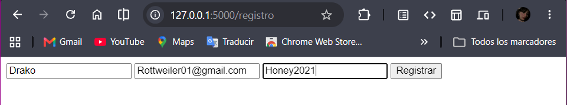
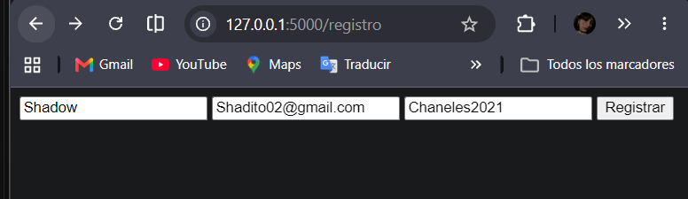
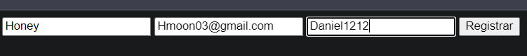
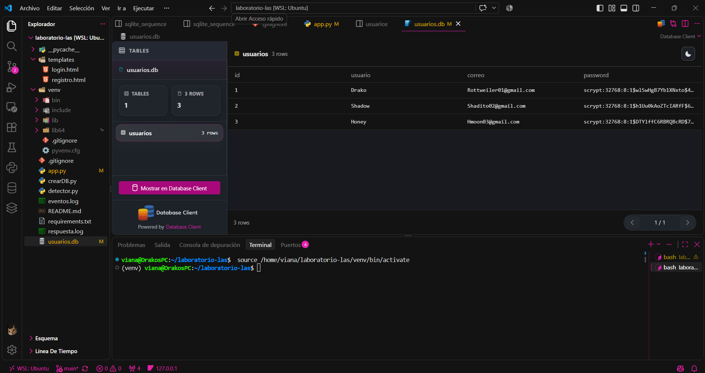
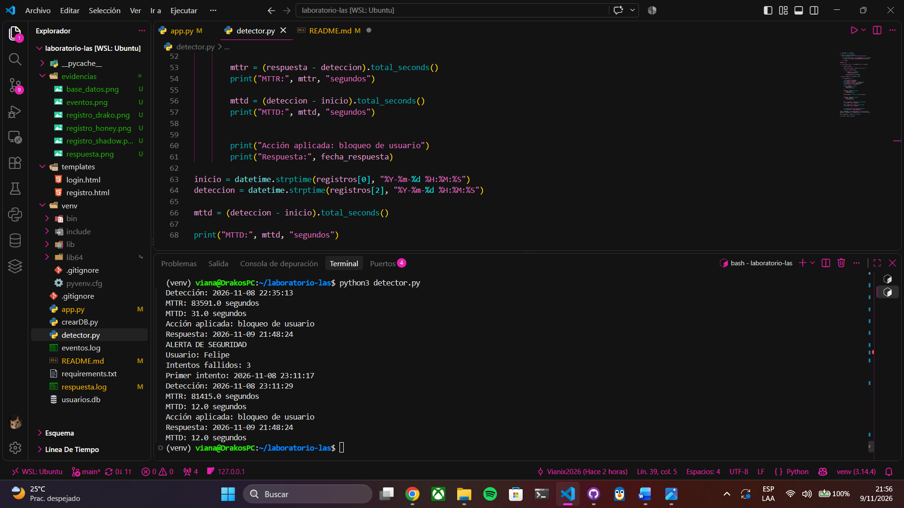
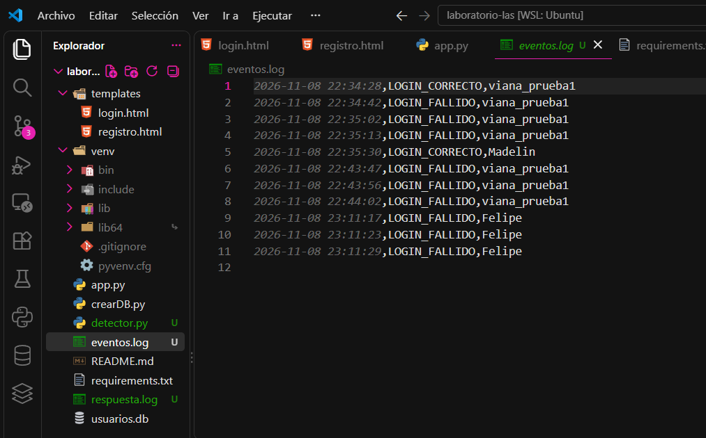
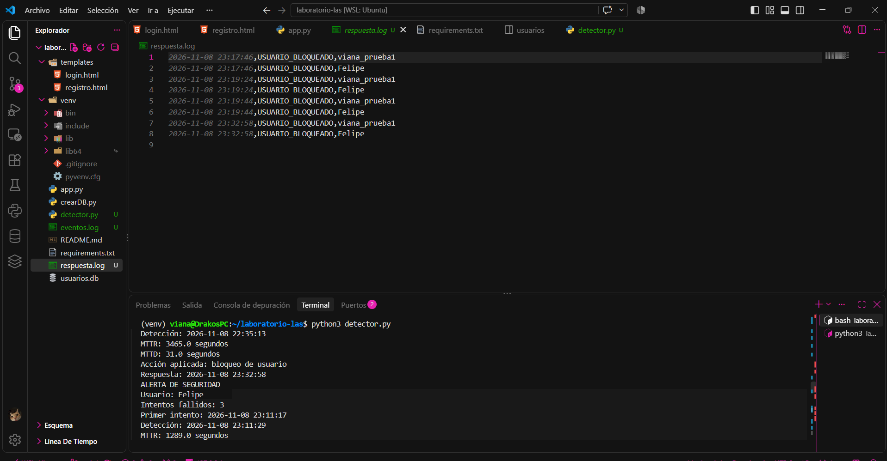

# Laboratorio: Código Seguro y Modelo OWASP

Aplicación web desarrollada con Python y Flask para implementar controles básicos de seguridad en el proceso de autenticación, registrar eventos y detectar incidentes mediante las métricas MTTD y MTTR.

## 1. Datos generales

- **Nombre completo:** Viana Pamela Galdámez González
- **Carné:** N/A
- **Correo electrónico:** vianagaldamez01@gmail.com
- **Asignatura:** Lenguajes de Programación con Aspectos de Seguridad
- **Tutor:** Dámaris Alas
- **Período de realización:** 02 al 08 de noviembre de 2026

## 2. Descripción del proyecto

El laboratorio consiste en desarrollar una aplicación web utilizando Python, Flask y SQLite, aplicando controles básicos de seguridad basados en buenas prácticas y el modelo OWASP.

La aplicación implementa funcionalidades de registro e inicio de sesión de usuarios, validación de entradas, consultas parametrizadas a la base de datos y protección de contraseñas.

También incorpora un mecanismo de registro de eventos de autenticación, detección de intentos fallidos de inicio de sesión y generación de alertas de seguridad. Ante la detección de un incidente, se registra una respuesta simulada.

Finalmente, se utilizan las métricas MTTD (Mean Time To Detect) y MTTR (Mean Time To Respond) para medir los tiempos de detección y respuesta ante incidentes.

## 3. Funcionalidades implementadas

### 3.1 Registro de usuarios

- Formulario de registro de usuarios.
- Validación de los datos ingresados.
- Validación de nombre de usuario y correo electrónico.
- Validación de contraseña.
- Almacenamiento de usuarios en una base de datos SQLite.

### 3.2 Inicio de sesión

- Formulario de autenticación.
- Validación de credenciales.
- Registro de eventos relacionados con la autenticación.
- Identificación de intentos fallidos de inicio de sesión.

### 3.3 Registro de eventos de seguridad

Los eventos de autenticación se almacenan en el archivo `eventos.log`, permitiendo analizar los intentos de acceso y detectar comportamientos sospechosos.

### 3.4 Detección de incidentes

El archivo `detector.py` analiza los eventos registrados y genera una alerta de seguridad cuando un usuario alcanza tres o más intentos fallidos de inicio de sesión.

La alerta permite visualizar información como:

- Usuario involucrado.
- Cantidad de intentos fallidos.
- Fecha y hora del primer intento.
- Fecha y hora de detección del incidente.
- Tiempo de detección (MTTD).

### 3.5 Registro de respuesta

La respuesta simulada ante el incidente se registra en el archivo `respuesta.log`. Este registro permite obtener el tiempo de respuesta (MTTR).

### 3.6 Reglas de validación y protección de datos

| Campo | Regla aplicada |
|---|---|
| Usuario | Entre 4 y 20 caracteres. |
| Usuario | Solo letras, números y guion bajo (`_`). |
| Correo electrónico | Validación del formato de correo electrónico. |
| Contraseña | Mínimo 8 caracteres. |

También se implementan las siguientes medidas:

- Eliminación de espacios innecesarios al inicio y al final del nombre de usuario y correo.
- Consultas SQL parametrizadas para interactuar con SQLite.
- Protección de contraseñas mediante hash.
- Registro de eventos de autenticación exitosos y fallidos.


## 4. Estructura del proyecto

```text

laboratorio-las/
├── evidencias/
│   ├── alertas de seguridad.png
│   ├── base_datos.png
│   ├── detector.png
│   ├── eventos.png
│   ├── registro_drako.png
│   ├── registro_honey.png
│   ├── registro_shadow.png
│   └── respuesta.png
├── templates/
│   ├── login.html
│   └── registro.html
├── app.py
├── crearDB.py
├── detector.py
├── eventos.log
├── respuesta.log
├── requirements.txt
├── usuarios.db
└── README.md
```

### Descripción de los archivos

| Archivo | Descripción |
|---|---|
| `app.py` | Aplicación web Flask, registro e inicio de sesión. |
| `crearDB.py` | Script para crear la base de datos SQLite. |
| `detector.py` | Analiza eventos, genera alertas y calcula las métricas de seguridad. |
| `templates/login.html` | Formulario de inicio de sesión. |
| `templates/registro.html` | Formulario de registro de usuarios. |
| `eventos.log` | Registro de eventos de autenticación. |
| `respuesta.log` | Registro de respuestas simuladas ante incidentes. |
| `usuarios.db` | Base de datos SQLite de usuarios. |
| `requirements.txt` | Dependencias necesarias para ejecutar el proyecto. |

> Los archivos de registros y la base de datos pueden actualizarse durante la ejecución de la aplicación.

**Importante:** Si ya existe una base de datos con información de usuarios, realizar una copia de seguridad antes de ejecutar el script de inicialización.


## 5. Tecnologías utilizadas

- Python
- Flask
- SQLite
- HTML
- Git
- GitHub
- Visual Studio Code
- Ubuntu mediante WSL

## 6. pruebas de registro y almacenamiento de usuarios

Se realizaron pruebas de registro mediante el formulario web de la aplicación, verificando que los datos ingresados fueran almacenados correctamente en la base de datos SQLite.

### 6.1 registro de usuarios

Se realizaron tres registros de prueba:

| ID | Nombre de usuario | Resultado |
|---|---|---|
| 1 | Drako | Registro exitoso |
| 2 | Shadow | Registro exitoso |
| 3 | Honey | Registro exitoso |

### 6.2 verificación en la base de datos

Después de completar los registros, se consultó la tabla `usuarios` de la base de datos `usuarios.db`.

Se comprobó lo siguiente:

- La tabla contiene tres registros.
- Cada usuario tiene un identificador único.
- Los nombres de usuario y correos electrónicos quedaron almacenados.
- Las contraseñas se almacenaron mediante hashes generados con `scrypt`, evitando guardar las credenciales en texto plano.

**Resultado:** las tres operaciones de registro finalizaron correctamente y los datos se visualizaron en SQLite mediante Database Client.

### 6.3 Evidencias

#### Registro del usuario Drako



#### Registro del usuario Shadow



#### Registro del usuario Honey



#### Verificación de usuarios en SQLite


---

**Observación sobre las pruebas:** Debido a inconvenientes técnicos durante la ejecución y el registro de los eventos, el detector presentó información correspondiente a registros históricos de usuarios anteriores (Viana y Felipe). Por esta razón, las evidencias y métricas disponibles corresponden a dichos registros y no fue posible obtener un reporte completo de los tres usuarios de prueba actuales.


## 7. Detección de incidentes de seguridad

Se realizaron pruebas de autenticación mediante la aplicación web, incluyendo inicios de sesión correctos e intentos fallidos con contraseñas incorrectas.

Durante la revisión de los registros se identificaron eventos históricos correspondientes a los usuarios Viana y Felipe. El detector procesó estos registros, identificó los intentos fallidos y generó las alertas correspondientes.

Debido a inconvenientes técnicos durante las pruebas, no fue posible conservar un reporte completo y verificable de los tres escenarios solicitados en la guía.

### 7.1 Evidencias

#### Pruebas de autenticación

**Registro de usuarios de prueba**


#### Evidencias de autenticación de usuarios históricos: Viana y Felipe

**Registro de usuario**


**Validación de usuario inválido**


**Intento de inicio de sesión con credenciales incorrectas**


#### Verificación de registros


#### Detección de incidentes

**Ejecución del detector**



**Alertas de seguridad generadas**


**Registro de eventos**



**Registro de respuestas**



**Nota:** Debido a inconvenientes técnicos durante las pruebas, el detector mostró registros históricos de usuarios anteriores, correspondientes a Viana y Felipe. Por ello, se documentan las evidencias y resultados que pudieron conservarse, sin atribuir esos registros a los usuarios de prueba actuales.


## 8. Métricas de seguridad

### 8.1 MTTD — Mean Time To Detect

El MTTD representa el tiempo transcurrido desde el primer intento fallido de autenticación hasta la detección del incidente.

**Fórmula:**

```text
MTTD = Hora de detección - Hora del primer intento fallido
```

En las pruebas realizadas, el detector identificó los siguientes tiempos:

- viana_prueba1: 31 segundos.
- Felipe: 12 segundos.

### 8.2 MTTR — Mean Time To Respond

El MTTR representa el tiempo transcurrido desde la detección del incidente hasta la respuesta registrada por el sistema.

**Fórmula:**

```text
MTTR = Hora de respuesta - Hora de detección
```

La acción registrada por el detector fue el bloqueo de usuario.

Los tiempos obtenidos fueron:

- viana_prueba1: 84,183 segundos.
- Felipe: 82,007 segundos.

### 8.3 Resultados de las pruebas

Durante la ejecución de `detector.py` se identificaron dos registros históricos de usuarios con intentos fallidos de autenticación.

| Usuario | Intentos fallidos | Primer intento | Detección | MTTD | MTTR |
|---|---:|---|---|---:|---:|
| viana_prueba1 | 6 | 08/11/2026 22:34:42 | 08/11/2026 22:35:13 | 31 segundos | 84,183 segundos |
| Felipe | 3 | 08/11/2026 23:11:17 | 08/11/2026 23:11:29 | 12 segundos | 82,007 segundos |

**Registro de respuestas:**

- **viana_prueba1:** respuesta registrada el 09/11/2026 a las 21:58:16.
- **Felipe:** respuesta registrada el 09/11/2026 a las 21:58:16.

El detector identificó los incidentes y registró la acción aplicada como bloqueo de usuario.

### 8.4 Cálculo de los promedios

**Promedio de MTTD:**

```text
(31 + 12) / 2 = 21.5 segundos
```

**Promedio de MTTR:**

```text
(84,183 + 82,007) / 2 = 83,095 segundos
```

**Resultados promedio:**

- MTTD promedio: **21.5 segundos**.
- MTTR promedio: **83,095 segundos (23 horas, 4 minutos y 55 segundos)**.

**Observación:** Los resultados corresponden a los dos registros históricos que mostró el detector. El tiempo de respuesta elevado se debe a la diferencia entre las fechas de detección y las fechas de respuesta almacenadas. No se presentan como tres escenarios independientes porque solo se pudieron verificar estos dos registros.

## 9. Instalación y ejecución

**Nota:** Para las pruebas de detección, la aplicación Flask debe permanecer ejecutándose en una terminal. El detector se ejecuta desde una segunda terminal, dentro del mismo directorio del proyecto y con el entorno virtual activado.


### Paso 1. Clonar el repositorio

```bash
git clone https://github.com/Vianix2026/laboratorio-las.git
cd laboratorio-las
```

### Paso 2. Crear el entorno virtual

En Ubuntu / WSL:

```bash
python3 -m venv venv
source venv/bin/activate
```

### Paso 3. Instalar las dependencias

```bash
pip install -r requirements.txt
```

### Paso 4. Crear la base de datos

```bash
python3 crearDB.py
```

### Paso 5. Ejecutar la aplicación

```bash
python3 app.py
```

Abrir en el navegador la dirección local que indique Flask, habitualmente:

```text
http://127.0.0.1:5000
```

### Paso 6. Ejecutar el detector de incidentes

Con la aplicación y los registros preparados, ejecutar:

```bash
python3 detector.py
```

El detector analiza los eventos registrados, presenta las alertas de seguridad y muestra los tiempos de detección y respuesta obtenidos.

## 10. Conclusión

El desarrollo de este laboratorio permitió aplicar controles básicos de seguridad en una aplicación web mediante Python y Flask.

Se implementaron mecanismos de validación de entradas, autenticación de usuarios, almacenamiento en SQLite y registro de eventos de seguridad.

Además, se desarrolló un detector de intentos fallidos de autenticación que genera alertas y permite calcular las métricas MTTD y MTTR.

Estas métricas permiten evaluar el tiempo empleado en detectar y responder a incidentes de seguridad, fortaleciendo la comprensión de los mecanismos básicos de detección y respuesta dentro de una aplicación web.

## 11. Uso académico

Proyecto desarrollado con fines académicos para la asignatura Lenguajes de Programación con Aspectos de Seguridad.